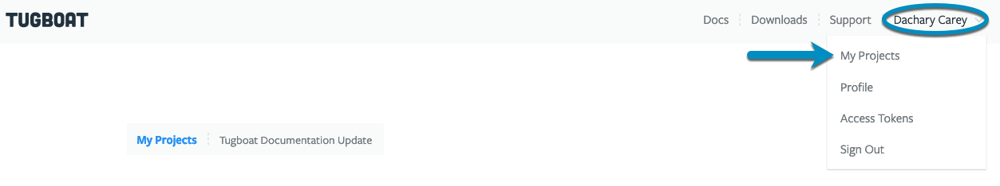
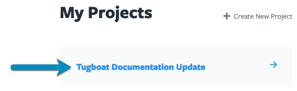
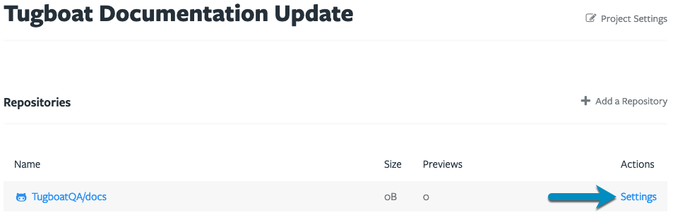
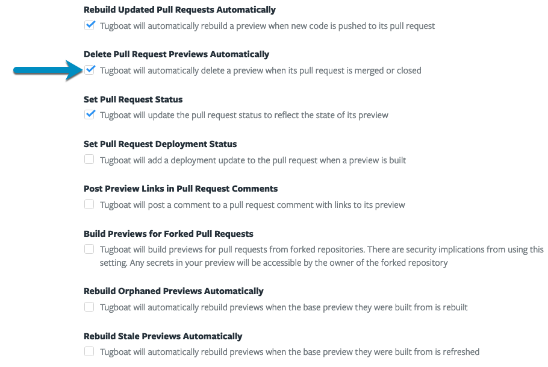
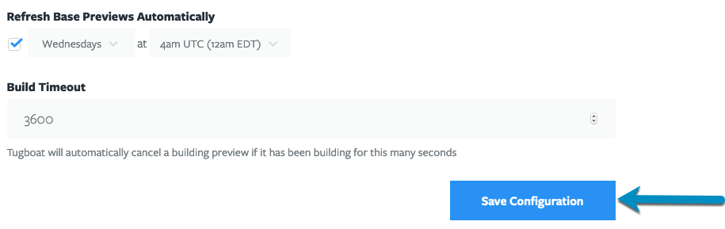

Each of the Previews in your Tugboat project counts toward the total storage space available in your
[project's billing tier](/tugboat-billing/tugboat-pricing/). Tugboat can delete Previews for you in two ways:

- [When their pull requests are merged or closed](#delete-previews-when-pull-requests-are-merged-or-closed). This is
  turned **on** by default.
- [After a number of days](#delete-previews-after-a-number-of-days). This is turned **off** by default.

## Delete Previews when pull requests are merged or closed

To turn this setting on or off:

1. Go to username -> [My Projects](https://dashboard.tugboatqa.com/projects) at the upper-right of the Tugboat screen.
2. Select the project where you want to configure auto-delete settings for Previews.
3. Click into {}Settings{} for the repository.
4. Click the {}Delete Pull Request Previews Automatically{} checkbox to change the setting.
   For GitLab, the checkbox is {}Delete Merge Request Previews Automatically{}.
5. Press the {}Save Configuration{} button to save your changes.

{}

Go to username -> [My Projects](https://dashboard.tugboatqa.com/projects) at the upper-right of the Tugboat screen.



Select the project where you want to configure auto-delete settings for Previews.



Click into {}Settings{} for the repository.



Click the checkbox to change the setting.



Press the {}Save Configuration{} button to save your changes.



{}

## Delete Previews after a number of days

You can have Tugboat delete new Previews a set number of days after they are created, whether or not they belong to an
open pull request.

To set the number of days:

1. Go to username -> [My Projects](https://dashboard.tugboatqa.com/projects) at the upper-right of the Tugboat screen.
2. Select the project that contains the repository.
3. Click into {}Settings{} for the repository.
4. In the {}Preview expiration{} field, enter the number of days after which Tugboat deletes
   a new Preview.
5. Press the {}Save Configuration{} button to save your changes.

Keep these details in mind:

- The default is `0`, which turns this setting off. Repositories keep their current behavior until you change it.
- The value must be a whole number from `0` to `1825` (5 years).
- Only repository admins can change this setting. Other users see the field, but cannot edit it.
- The setting applies only to Previews that are created or cloned after you save it. Each new Preview is set to expire
  that many days after it is created. Existing Previews, including ones you rebuild or refresh, are not affected. To
  give an existing Preview an expiration date, [set one with the CLI](#set-an-expiration-date-on-a-preview).
- Setting it back to `0` does not remove expiration dates that Previews already have.
  [Remove them with the CLI](#remove-an-expiration-date-from-a-preview).
- Tugboat does not give [Base Previews](/building-a-preview/work-with-base-previews/set-a-base-preview/) an expiration
  date. When you set a Preview as a Base Preview, Tugboat clears its expiration date.
- If you set an `expires` date when you create or clone a Preview with the CLI, Tugboat uses that date instead of the
  repository setting.
- Tugboat does not delete a [locked Preview](/building-a-preview/administer-previews/change-preview-states/#lock-unlock)
  until you unlock it. To keep a Preview past its expiration date, lock it. If the date has already passed, Tugboat
  deletes the Preview within about 10 minutes of unlocking it.

### Set the number of days with the CLI

To set the repository setting with the CLI, for example to delete new Previews after 14 days:

```sh
tugboat update <repo-id> expire_days=14
```

Use `0` to turn the setting off. A value above `1825` returns an `Invalid attribute value (Error 1150): expire_days`
error.

To see the current setting, look for `Delete new previews after` in the repository's verbose output (CLI 2.26.45 or
later). The line shows `None` when the setting is `0`.

```sh
tugboat ls <repo-id> -v
```

```
  Delete new previews after: 14 days
```

## Find out when a Preview will be deleted

When a Preview has an expiration date, the Preview's page and its card in the list of Previews show the date below the
build time, for example {}Deletes January 21, 2027{}. For a locked Preview, the date is
followed by "if unlocked". The date is shown in your local time zone.

Tugboat deletes the Preview within about 10 minutes after its expiration time.

### View Preview expiration dates with the CLI

The CLI shows the exact date and time, in UTC, in the `expires` field of a Preview's JSON output. The value is `null`
when the Preview has no expiration date.

```sh
tugboat ls <preview-id> -j | grep '"expires"'
```

```
  "expires": "2027-01-22T00:44:54.498Z",
```

If you have [jq](https://jqlang.org/) installed, you can list every Preview in a repository with its expiration date,
and whether it is a Base Preview:

```sh
tugboat ls previews repo=<repo-id> -j | jq -r '.[] | "\(.id)  \(if .anchor then "base" else "-   " end)  \(.expires // "none")  \(.name)"'
```

```
5b04c7d14c3dad00016a2e80  base  none  main
5d1a5305216a15d4bf5dcbbb  -     2027-01-22T00:44:54.498Z  Update the header styles
```

## Set an expiration date on a Preview with the CLI

You can use the CLI to add, change, or remove the expiration date on any Preview, including Previews that existed before
you turned on the repository setting. The 1825-day maximum does not apply to dates that you set on a single Preview, but
the date must be in the future.

To set or change the expiration date:

```sh
tugboat update <preview-id> expires=2027-02-01
```

{} An expiration date that you set yourself also applies to Base Previews. If you set `expires` on a
Base Preview, Tugboat deletes it on that date. {}

{} Dates without a time zone use UTC, and dates without a time use midnight. Because the Preview's page
shows the date in your local time zone, it can show the day before the date you entered. To set an exact time, include a
time and a time zone, for example `expires=2027-02-01T17:00:00-05:00`. {}

## Remove an expiration date from a Preview with the CLI

To remove a preview's manually-set expiration date:

```sh
tugboat update <preview-id> expires=null
```
