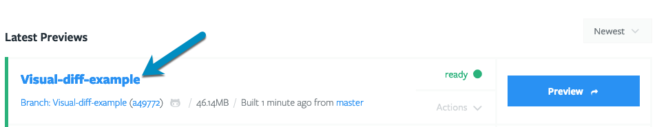

When you configure Tugboat to generate Google Lighthouse reports for your web app or website, you'll see a Lighthouse
Reports status on your pull requests. To go directly to the Lighthouse reports in the Tugboat Preview Dashboard, click
the {}Details{} link for the status. On GitHub, the {}Details{}
link is in the {}…{} menu next to the status.

Alternately, to view Lighthouse reports from within Tugboat, here's how to get to the Preview Dashboard:

## To view Lighthouse reports:

1. Click into a Preview that has finished building.
2. Scroll down past the Services and you'll see the Lighthouse Reports pane.
3. Find the report for the URL you want. Each report lists the URL, the screen it ran against (Desktop or Mobile), and
   the scores for the Performance, Accessibility, Best Practices, and SEO categories.
4. Click one of the scores or the {}Details{} button to expand the report. The expanded
   report shows a score graph for each category.
5. Click a score graph, or the {}Full Report{} link, to open the full Lighthouse report in a
   new tab.

Inside the Lighthouse report, you'll see a list of audit items that were checked to provide your score. For more
information on what you'll see in Lighthouse reports, take a look at:
[Using Lighthouse -> What do Lighthouse reports measure?](../using-lighthouse/#what-do-lighthouse-reports-measure)

To view the reports for a single Service, click into the Service from the Preview Dashboard. The Service page has its
own Lighthouse Reports pane.

If you have defined thresholds for your reports, the pane also shows tabs and pass/fail status. Each report shows its
status in place of its scores, and failed or rejected reports open expanded. For more information, see:
[Use Lighthouse Thresholds](../use-lighthouse-thresholds/).

## Regenerate Lighthouse reports

You can regenerate a single report, or all of the reports for a Preview or Service. Tugboat asks you to confirm before
it regenerates.

### To regenerate a single report:

1. [View the Lighthouse reports](#to-view-lighthouse-reports) and expand the report.
2. Click the {}Regenerate{} button.
3. In the dialog, click {}Regenerate{} to confirm, or {}Cancel{}
   to keep the current report.

### To regenerate all reports:

1. [View the Lighthouse reports](#to-view-lighthouse-reports).
2. Click the {}Regenerate All Reports{} button on the Preview Dashboard, or the
   {}Regenerate All{} button on a Service page.
3. In the dialog, click {}Regenerate{} to confirm.

While Tugboat generates a report, you'll see {}Queued{} and then
{}Generating{} next to it. If Tugboat can't generate a report, the report shows the error
message and a {}Regenerate{} button. If the reports don't have thresholds, a banner above the
reports shows how many failed to generate. To regenerate them all, click {}Regenerate
errored{} in the banner. If the reports have thresholds, use the {}Error{} tab
instead. See: [Regenerate reports by status](../use-lighthouse-thresholds/#regenerate-reports-by-status).

{} While the Preview is building, you'll see: "Unavailable while preview is building" in the Lighthouse
Reports pane. After the Preview build has completed, the Lighthouse reports will generate. {}

{}

Click into a Preview that has finished building;

Scroll down past the Services, and you'll see the Lighthouse Reports pane;

Click one of the scores or the {}Details{} button to expand the report, then click the
{}Full Report{} link to open the full Lighthouse report.

Inside the Lighthouse report, you'll see a list of audit items that were checked to provide your score.

Click the {}Regenerate{} button to regenerate a report, then confirm in the dialog.

{}
