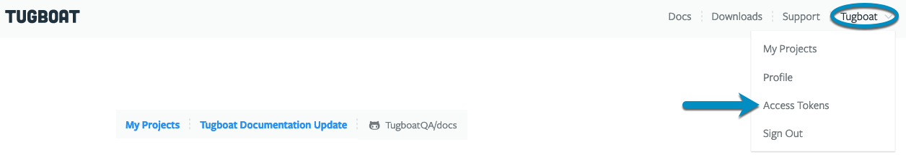
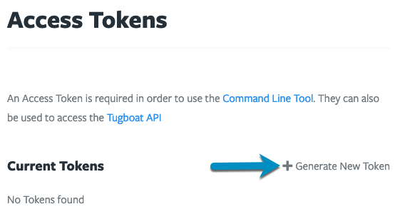
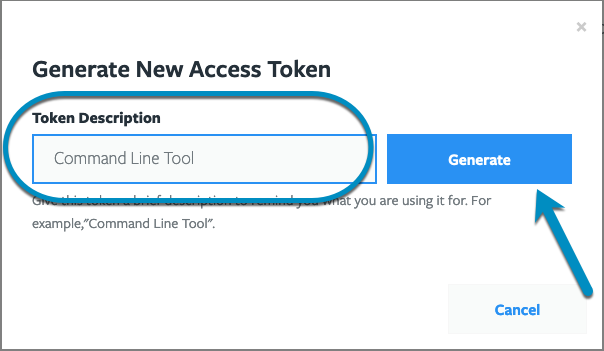
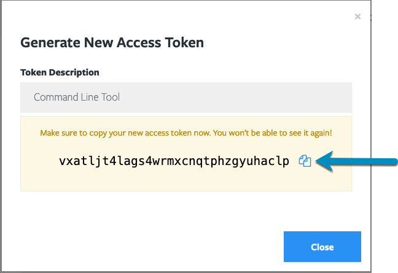
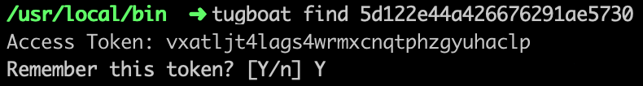

The first time you attempt to access a Tugboat resource in the Command Line Interface (CLI), you'll be asked for an
Access Token. You can sign in with your browser and have the CLI save an Access Token for you, or you can create an
Access Token in the dashboard and paste it in.

## Sign in with your browser

To sign in with your browser:

1. Run the following command:

   ```sh
   tugboat login
   ```

2. The CLI opens the Tugboat dashboard in your browser and prints a code in your terminal. Enter the code on the page
   and approve the request.
3. The CLI saves a new Access Token and the dashboard address to the `.tugboat.yml` file in your home directory. The
   token appears on the dashboard's Access Tokens page with the type {}CLI login{}.

The dashboard address must use HTTPS. The `tugboat login` command accepts these options:

- `--dashboard=<url>` sets the dashboard address. Use this for on-premise installs, or set the `TUGBOAT_DASHBOARD`
  environment variable or the `dashboard` key in `.tugboat.yml`. By default, the CLI uses
  `https://dashboard.tugboatqa.com`.
- `--no-browser` prints the address instead of opening a browser. Use this when you connect over SSH.

For example, to sign in to an on-premise install:

```sh
tugboat login --dashboard=https://dashboard.example.com
```

## Create an Access Token manually

To create an Access Token in the dashboard and paste it into the CLI:

1. In Tugboat's web interface, go to User Name -> Access Tokens, or
   [click this link](https://dashboard.tugboatqa.com/access-tokens).
2. Click the {}Generate New Token option{}.
3. You'll be asked to give the Access Token a description; for example, "Command Line Tool"; enter a description and
   press the {}Generate{} button.
4. Make sure you save your Access Token somewhere safe, such as [1Password](https://1password.com/) or other password
   manager.
5. When you run the CLI, and attempt to access a resource, you'll be asked for an Access Token; paste it in and hit `Y`
   to remember it.

{} 1Password users can install
[a shell plugin for the 1Password CLI](https://developer.1password.com/docs/cli/shell-plugins/tugboat) so that your
Tugboat token will be encrypted, stored securely, and accessible from any machine. Thank you to Mark Dorison of
[Chromatic](https://chromatichq.com) for contributing this plugin. {}

Now you're all set to use the Tugboat Command Line Interface!

{}

In Tugboat's web interface, go to User Name -> Access Tokens, or
[click this link](https://dashboard.tugboatqa.com/access-tokens).



Click the {}Generate New Token{} option.



You'll be asked to give the Access Token a description; for example, "Command Line Tool"; enter a description and press
the {}Generate{} button.



Make sure you save your Access Token somewhere safe, as you won't be able to see it again!



When you run the CLI, and attempt to access a resource, you'll be asked for an Access Token; paste it in and hit `Y` to
have the CLI remember it.



{}
