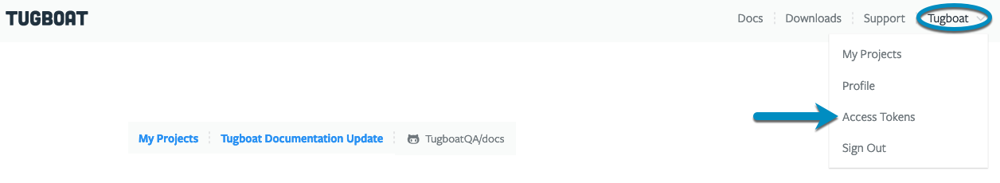
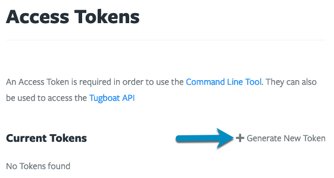
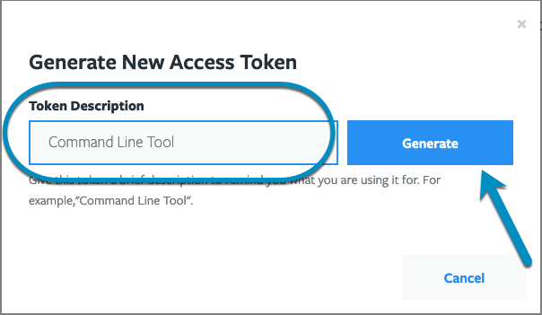
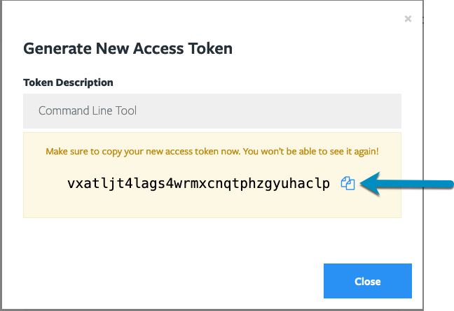
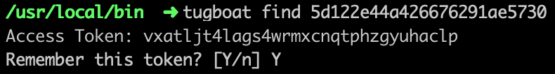

The first time you attempt to access a Tugboat resource in the Command Line Interface, you'll be asked for an Access
Token.

To set an Access Token:

1. In Tugboat's web interface, go to User Name -> Access Tokens, or
   [click this link](https://dashboard.tugboatqa.com/access-tokens).
2. Click the {}Generate New Token option{}.
3. You'll be asked to give the Access Token a description; for example, "Command Line Tool"; enter a description.
4. Choose a {}Role{} for the Access Token. The default is {}Full
   access{}. See [Access Token roles](#access-token-roles).
5. Press the {}Generate{} button.
6. Make sure you save your Access Token somewhere safe, such as [1Password](https://1password.com/) or other password
   manager.
7. When you run the CLI, and attempt to access a resource, you'll be asked for an Access Token; paste it in and hit `Y`
   to remember it.

{} 1Password users can install
[a shell plugin for the 1Password CLI](https://developer.1password.com/docs/cli/shell-plugins/tugboat) so that your
Tugboat token will be encrypted, stored securely, and accessible from any machine. Thank you to Mark Dorison of
[Chromatic](https://chromatichq.com) for contributing this plugin. {}

Now you're all set to use the Tugboat Command Line Interface!

## Access Token roles

Each Access Token has a role. You choose the role when you generate the Access Token, and you can't change it later. The
Access Tokens page shows the role of each token in the {}Role{} column.

- {}Full access{}: The token can do everything you can do. Access Tokens that you created
  before roles were available have full access.
- {}Sandbox agent{}: The token can only work with Sandbox Previews that you own.

When a token's role doesn't permit an operation that you could perform, the API returns error `1163`,
`Access token role does not permit this operation`. For more information, see
[Tugboat Error Codes](/reference/tugboat-error-codes/).

To set the role when you create an Access Token with the CLI, pass `role=full` or `role=sandbox`:

```sh
tugboat create key "My agent" role=sandbox
```

{}

In Tugboat's web interface, go to User Name -> Access Tokens, or
[click this link](https://dashboard.tugboatqa.com/access-tokens).



Click the {}Generate New Token{} option.



You'll be asked to give the Access Token a description; for example, "Command Line Tool". Enter a description, choose a
{}Role{}, and press the {}Generate{} button.



Make sure you save your Access Token somewhere safe, as you won't be able to see it again!



When you run the CLI, and attempt to access a resource, you'll be asked for an Access Token; paste it in and hit `Y` to
have the CLI remember it.



{}
